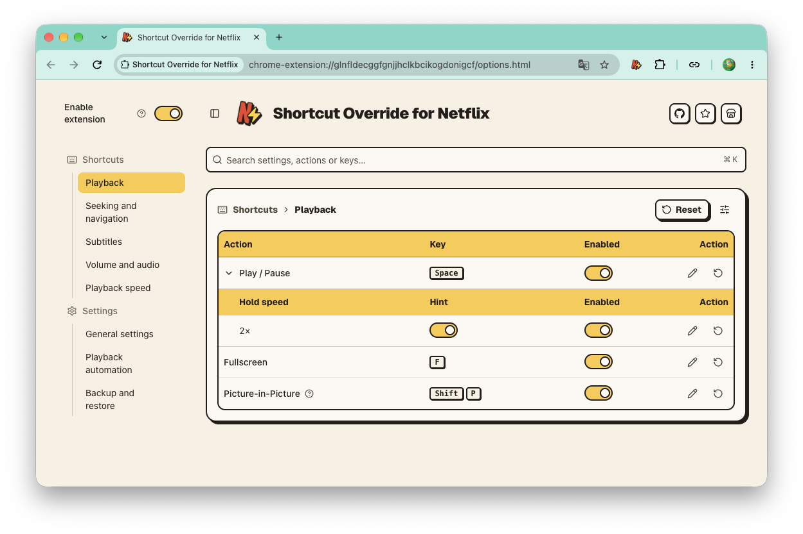

# Shortcut Override for Netflix

English · [繁體中文](docs/readme/zh-TW.md) · [简体中文](docs/readme/zh-CN.md) · [日本語](docs/readme/ja.md) · [한국어](docs/readme/ko.md)

[](https://github.com/chenghsj/netflix-shortcut-override/actions/workflows/ci.yml)
[](https://github.com/chenghsj/netflix-shortcut-override/releases/latest)
[](LICENSE)

Customize Netflix playback shortcuts, navigate subtitles, and watch in Picture-in-Picture with subtitle support.

This is an unofficial extension, not affiliated with, endorsed by, or sponsored by Netflix.

[Install](#install) · [Quick start](#quick-start) · [Shortcuts](#default-shortcuts) · [Settings](#settings-and-customization) · [Picture-in-Picture](#picture-in-picture) · [Backups](#backup-sync-and-reset) · [Troubleshooting](#troubleshooting)

## Preview



The Options page in the Neobrutalism style. Classic is also available, with light, dark, or system brightness.

## Install

[](https://chromewebstore.google.com/detail/shortcut-override-for-net/jebnhiecgnchnioahfagmnebdknddbom)
[](https://microsoftedge.microsoft.com/addons/detail/shortcut-override-for-net/ddfnieehcebicbmnejlafjphppdjmdhi)
[](https://addons.mozilla.org/firefox/addon/70ea1dc7212746bd96bd/)

Install from your browser's store, open a Netflix video, and use the toolbar popup to check status or open Options.

For manual installation, download a browser package from [GitHub Releases](https://github.com/chenghsj/netflix-shortcut-override/releases/latest):

- **Chrome / Edge:** extract the Chromium ZIP, enable Developer mode in `chrome://extensions` or `edge://extensions`, and choose **Load unpacked**. Select the folder containing `manifest.json`.
- **Firefox:** open `about:debugging#/runtime/this-firefox`, choose **Load Temporary Add-on…**, and select the Firefox ZIP. This installation lasts until the browser restarts; use Firefox Add-ons for persistent installation and automatic updates.

Choose the `chromium` or `firefox` ZIP for installation; the `source` ZIP is for building from source. For beta builds, open the [release list](https://github.com/chenghsj/netflix-shortcut-override/releases) and choose a prerelease. See the [beta installation guide](docs/release.md#beta-releases). Disable another installation of this extension while testing a manual build to avoid duplicate shortcut handling, and use a settings backup to transfer your preferences.

This README describes the current source. Store packages and stable releases may have fewer features; check the release notes for the build you install.

## Quick Start

1. Open a Netflix video. If Netflix was already open when you installed or reloaded the extension, refresh that tab.
2. Open the extension's toolbar popup and confirm **Enable extension** is on. It is on by default; the popup also shows your saved shortcuts and compatibility status.
3. Close the popup, click the video to focus playback, and try `Space` to play/pause or `Left` / `Right` to seek.
4. Choose **Open settings** from a shortcut category to edit its keys and preferences in Options. Most switches save immediately; editor dialogs apply changes when you select **Save**.

Ordinary shortcuts and `2x` hold speed are enabled by default. Subtitle navigation, automatic skipping, automatic next episode, and hiding the pause overlay are opt-in.

## Features

- Customize shortcuts, leave keys unassigned, enable or disable actions, and resolve key conflicts in Options.
- Control playback, frame stepping, seeking, episode navigation, volume, fullscreen, and playback speed.
- Add seek pairs, jumps to a video percentage, and preferred-speed shortcuts; customize the subtitle-size cycle.
- Cycle through favorite subtitle and audio tracks in your chosen order, including audio-description variants.
- Jump to the previous or next subtitle, or replay the current one.
- Watch in Picture-in-Picture with mirrored Netflix subtitles and playback controls on Chrome and Edge.
- Hold the Play / Pause key for temporary speed adjustment, then release to restore the original speed.
- Automatically skip intros and recaps or advance to the next episode; optionally hide Netflix's pause overlay.
- Check compatibility and copy local diagnostics from the toolbar popup.
- Sync settings through browser storage, export/import backups, and choose from ten interface languages and three interface styles.

## Default Shortcuts

The 23 built-in actions below follow the current Options categories. All playback keys can be changed or disabled. Upgrades preserve saved assignments, so the popup is the reference for your current keys.

### Playback

| Action | Default key | Behavior |
| --- | --- | --- |
| Play / Pause | `Space` | Tap to play/pause; hold for temporary speed. |
| Previous episode | `Shift + P` | Use Netflix's episode picker to play the preceding available episode. |
| Next episode | `Shift + N` | Use Netflix's next-episode control or episode picker. |
| Fullscreen | `F` | Toggle fullscreen on the Netflix page; unavailable inside PiP. |
| Picture-in-Picture | `P` | Open/close subtitle-preserving PiP on Chrome/Edge 116+. |

### Seeking and navigation

| Action | Default key | Behavior |
| --- | --- | --- |
| Previous frame | `,` | Pause, move back one frame, and remain paused. |
| Next frame | `.` | Pause, move forward one frame, and remain paused. |
| Skip intro | `S` | Click a recognized visible Netflix skip button for an intro, recap, or credits. |
| Forward | `→` | Forward 10 seconds by default; built-in interval: 1–300 seconds. |
| Rewind | `←` | Rewind by the same interval as Forward. |

### Subtitle language and size

| Action | Default key | Behavior |
| --- | --- | --- |
| Toggle subtitles | `C` | Turn native Netflix subtitles off/on, restoring the last available track. |
| Cycle subtitle size | `Shift + C` | Cycle 80% → 100% → 125%; starts at 100%, so the first press selects 125%. |
| Next subtitle language | `Shift + X` | Select the next available subtitle/favorite; wrap at the end. |
| Previous subtitle language | `Shift + Z` | Select the previous available subtitle/favorite; wrap at the start. |

### Volume and audio

| Action | Default key | Behavior |
| --- | --- | --- |
| Volume up | `↑` | Increase volume by 5 percentage points. |
| Volume down | `↓` | Decrease volume by 5 percentage points. |
| Mute | `M` | Toggle mute. |
| Previous audio language | `Shift + A` | Select the previous audio track/favorite, including Audio Description variants. |
| Next audio language | `Shift + D` | Select the next audio track/favorite, including Audio Description variants. |

### Playback speed

| Action | Default key | Behavior |
| --- | --- | --- |
| Increase speed | `Shift + .` | Increase by 0.25x by default, within the configured speed range. |
| Decrease speed | `Shift + ,` | Decrease by 0.25x by default, within the configured speed range. |
| Reset speed | `Shift + /` | Return to 1x. |
| Set preferred speed | `Shift + Quote` | Apply the configured preferred speed; default 1.5x. |

Hold Play / Pause for about 250 ms to use the hold speed (default `2x`); release to restore the previous speed and playing/paused state. This follows your remapped Play / Pause key. Holding a seek or frame-step key repeats that action; exact frame accuracy depends on Netflix. Track switching, subtitle-size cycling, preferred-speed, percentage, and episode shortcuts act once per press.

Bindings use physical key positions plus modifiers. `Quote` means the quote key (`'` / `"` on a US keyboard); the popup may display it as `Shift + "`. See [Subtitle navigation](#subtitle-navigation) for the four separately enabled sentence actions and [Settings](#settings-and-customization) for custom shortcuts.

### Settings Interface Shortcuts

These shortcuts operate in the extension interface and are separate from the editable Netflix playback bindings.

| Action | macOS | Windows / Linux |
| --- | --- | --- |
| Focus search in Options or the toolbar popup | `⌘ + K` | `Ctrl + K` |
| Switch Options pages in sidebar order | `⌘ + 1`–`⌘ + 9` | `Ctrl + 1`–`Ctrl + 9` |

In Options, 1–9 select Playback, Seeking and navigation, Subtitles, Volume and audio, Playback speed, General settings, Playback preferences, Backup and restore, and User guide. Hold `⌘` / `Ctrl` for about 300 ms to show the sidebar number hints. `Esc` clears search. Category shortcuts are inactive in editing dialogs and during key recording.

## Settings and Customization

Open **User guide** below Backup and restore in the Options sidebar or from the popup footer for searchable, collapsible instructions in all ten interface languages. Its 11 concise topics cover four categories: Quick start, Shortcut settings, Backup and recovery, and Permissions and privacy, with links to relevant settings. Feature-specific tips appear beside their controls; see the [detailed user guide](docs/user-guide.md) for the full reference.

Use the Options sidebar to choose a shortcut category, General settings, Playback preferences, or Backup and restore. Search settings, action names, language names, or keys across all ten interface languages. The toolbar popup provides searchable shortcut reference and compatibility status; **Open settings** opens the corresponding Options page for editing.

- **Seeking:** set the built-in or any custom rewind/forward pair to 1–300 seconds, with separate keys for each direction, or add a jump to 0–100% of the video. Older custom intervals above 300 seconds become 300 seconds on upgrade while retaining their keys.
- **Subtitle size:** edit the default 80% → 100% → 125% cycle with 2–6 different whole percentages from 50–300%, and drag to set their order. 100% restores the original size; this scales captions locally without changing Netflix account preferences. Regular playback and PiP keep their current sizes separately. Previously saved longer cycles are preserved, and fixed-size or extra cycle shortcuts remain editable and removable.
- **Playback speed:** add preferred-speed shortcuts from `0.25x` to `5x`. Edit each speed and key together; configure hold speed beneath Play / Pause and speed limits and steps on the Playback speed page.
- **Favorite tracks:** add subtitle languages or audio tracks in batches, then drag to set their switching order. Audio Description tracks are separate choices. Shortcuts skip unavailable favorites; an empty list cycles through all available tracks. Favorites apply when switching with shortcuts and do not automatically select a track when a title opens.
- **Page features:** use **Manage page features** to hide unused controls and disable their shortcuts while retaining saved keys and values. Showing a feature again enables its shortcuts when their keys are free. You can also clear a key in its editor and save it as **Not set**.
- **Appearance:** choose Classic or Neobrutalism independently of light/dark mode or the system theme. Existing/imported Markdown settings remain active and correctly labeled until you switch away.

Custom seek pairs, percentage jumps, and additional preferred speeds start empty and have no predefined keys; assign them when adding each entry. Hold speed shares the Play / Pause binding. Automatic skipping and next-episode automation use switches rather than additional shortcut keys.

In **Playback preferences**, enable **Automatically skip intro**, **Automatically skip recap**, or **Automatically play next episode** independently. Each clicks the matching Netflix button when it becomes visible. **Hide pause overlay** hides the paused title, synopsis, and dark backdrop while keeping subtitles and playback controls visible. These options are all off by default.

### Editing Keys and Resolving Conflicts

Select a row's pencil, record your key combination, and select **Save**. Choose **Add shortcut** to keep the existing key and add another, up to three keys per action. Remove keys individually; saving discards empty fields and promotes the first remaining key. Clear or remove every key and save to leave the action unassigned.

If another enabled action owns a key, choose a different combination or explicitly transfer it; transferring disables the previous action and both directions if it belongs to a seek pair. All keys for an action share its enabled state. Disabled rows retain their complete key lists and release them for reuse; Options, popup reference, search and backups include every assigned key.

For episode controls, add `MediaTrackNext` alongside `Shift+N` or `MediaTrackPrevious` alongside `Shift+P` if the browser delivers that key to the recorder. During playback, assigned track keys also route through browser Media Session controls. Keys consumed by the operating system or browser may not reach the recorder.

Assigned play/pause, stop, fast-forward and rewind keys also accept browser Media Session controls. When assigned to Play / Pause, Play resumes and Pause or Stop pauses, without hold speed. Unassigned controls keep Netflix's behavior. Volume keys still require keyboard events.

Media keys can use Ctrl, Alt, Shift or Command/Win when the browser delivers the full keyboard event. For example, `Ctrl+MediaTrackNext` and `MediaTrackNext` are distinct shortcuts. Paired keyboard/media notifications run only the delivered key combination. Every configured browser-only control waits up to 120ms, then uses the plain-key assignment or Netflix's handler; it never guesses a modifier. Keyboard input selects its exact assignment immediately; older playback may wait for a newer tentative media notification to settle, and unassigned combinations do not trigger a plain-key shortcut even when no modifier binding is configured.

Remapping a supported Netflix shortcut such as Play / Pause or Forward suppresses its original Netflix key only while that action is enabled, has an assigned key, and no longer retains the original key in its list. Disabling the action, clearing all its keys, or turning off the extension releases that suppression.

For example, add a 90-second seek pair, a jump to 50%, or separate `1.25x` and `2x` preferred-speed keys. Custom entries can be edited, disabled, or deleted independently.

### Playback Speed Defaults

| Setting | Default | Configurable range |
| --- | --- | --- |
| Lowest speed | `0.25x` | `0.25x`–`1x` |
| Highest speed | `3x` | `1x`–`5x` |
| Speed change | `0.25x` | `0.05x`–`5x` |
| Preferred speed | `1.5x` | `0.25x`–`5x` |
| Hold speed | `2x` | `0.25x`–`5x` |

Speed values use `0.05x` increments. Hold speed and its hint can be toggled separately. Changing speed with another speed shortcut during a hold keeps that new speed when you release Play / Pause. Reset playback speed returns to `1x`.

To reach `5x` with Increase speed, set **Highest speed** to `5x` under **Playback speed → Range and step**. To jump directly to `5x`, edit the built-in preferred-speed row or add another preferred-speed shortcut and save its speed and key together.

## Subtitle Navigation

Subtitle navigation is **off by default**:

1. Open Options and turn on **Enable extension**.
2. Open **Shortcuts → Subtitles → Sentence jumps and replay**, turn on **Enable**, and allow Netflix/subtitle website access if prompted.
3. Select a subtitle track in Netflix.

| Action | Default key | Behavior |
| --- | --- | --- |
| Previous subtitle | `A` | Jump to the preceding subtitle start; preserve playing/paused state. |
| Next subtitle | `D` | Jump to the next subtitle start; preserve playing/paused state. |
| Replay current subtitle | Not set (disabled) | Assign a key and enable it to seek to the current subtitle start and play once. |
| Play / Pause | `W` | Toggle playback immediately, without hold speed. |

`A` and `D` preserve the playing or paused state. Replay starts playback from the current subtitle; it does not loop or stop at its end. `W` toggles playback immediately, without hold speed.

**Subtitle navigation does not override ordinary shortcuts.** An enabled shortcut keeps its key. Choose another subtitle key or explicitly transfer it in the conflict dialog. Existing duplicate settings keep the ordinary shortcut active; `S` continues skipping the intro until its key is explicitly reassigned.

If website access is denied, the feature stays off. Turn it on again to retry. These shortcuts also work in the extension-managed Picture-in-Picture window on Chrome and Edge.

Timings load on demand for the selected video and subtitle track. The first jump may show a loading hint; changing the episode or subtitle track loads its timings again. The feature follows your selected subtitles without changing their language.

## Picture-in-Picture

On Chrome or Edge 116+, press `P` while a Netflix video is open to enter the extension's subtitle-preserving PiP window. Press it again or close the window to return the video to Netflix. Keep the source tab open.

- Resize the floating window; the video keeps its aspect ratio.
- Click the video to play/pause. Use the controls to seek, mute, adjust volume, or click/drag the timeline. Controls hide after three seconds of pointer inactivity.
- The subtitle menu follows Netflix's subtitle on/off state and lets you choose subtitle size and no background, a translucent background, or a dark background. It mirrors the selected Netflix subtitles.
- Playback shortcuts and enabled subtitle-navigation keys also work while the PiP video has focus. Fullscreen is available on the source Netflix page.
- A confirmed episode transition closes PiP and returns playback to Netflix. Open PiP again for the next episode.

Firefox's built-in PiP is separate from this feature; this extension's PiP shortcut and subtitle controls are disabled there.

## Backup, Sync, and Reset

Settings use your browser's sync storage. Cross-device sync depends on the browser's account and sync configuration; use JSON backups to move settings between browsers, profiles, or store/manual installations.

1. Open **Options → Backup and restore → Export settings** to download a JSON file with your keys, enabled states, custom entries, favorite tracks, appearance, and playback preferences.
2. In the destination installation, choose **Import settings** and select the file.
3. Review the summary and confirm. Import **replaces** current settings. Supported older backups are migrated; invalid or unsupported newer files are rejected before replacement. Export the destination's settings first if you want a way back.

Reset controls have different scopes:

- **Restore defaults** in Backup and restore resets all settings after confirmation, including custom shortcuts, favorite tracks, hidden features, language, theme and interface style. Export a backup first if you want to retain your preferences.
- **Reset general shortcuts** restores all ordinary shortcut keys and enabled states, removes custom seek/preferred-speed/subtitle-size entries, and restores the subtitle-size cycle. Subtitle-navigation keys and other preferences are retained.
- **Reset subtitle navigation** restores its four rows while retaining its master switch. Default keys already owned by enabled ordinary shortcuts stay disabled.
- Individual settings have narrower resets, such as only the seek interval, speed range/step, or hold-speed settings. Read the reset description before confirming.

## Supported Languages

The interface follows supported browser UI languages automatically, or you can choose English, Traditional Chinese, Simplified Chinese, Japanese, Korean, Spanish, Brazilian Portuguese, French, German, or Indonesian in Options.

## Browser Support and Limitations

- Supports Chrome 111+, Edge 111+, and Firefox Desktop 128+. The extension's subtitle-preserving Picture-in-Picture feature requires Chrome or Edge 116+; it is disabled on Firefox.
- Shortcuts work on Netflix watch pages or pages with a visible player, and are skipped while typing in editable fields.
- Fullscreen is available only on the Netflix page. Skip intro requires a visible Netflix skip button.
- Seeking, subtitle switching, and subtitle navigation depend on undocumented Netflix player interfaces and may need updates when Netflix changes them.

## Permissions

- **Netflix website access:** run playback shortcuts and read the selected subtitle track.
- **Optional `https://*.nflxvideo.net/*` access:** download subtitle documents when navigation is requested. Access is requested when you enable subtitle navigation; no content scripts run on this CDN host.
- **Storage, scripting, and active tab:** save settings, execute playback actions, check compatibility, and restore playback focus. The popup reloads Netflix only when you select the recovery action.

Turning subtitle navigation off does not revoke website access already granted. See the [permission details](docs/user-guide.md#permissions) and [troubleshooting guide](docs/troubleshooting.md#subtitle-website-access).

## Privacy

No analytics, tracking, or third-party processing services. Subtitle documents are retrieved from Netflix delivery hosts and parsed locally; their timing cache stays in memory. Settings use browser sync storage, and compatibility diagnostics stay on your device unless you copy and share them.

Read the full [privacy policy](PRIVACY.md).

## Troubleshooting

- **Keys do nothing:** confirm the global and individual action switches are on, close the popup, and focus the video. Editable fields keep their normal typing behavior. Check the popup for the currently assigned key.
- **Extension is inactive or still checking:** use **Reload Netflix** when offered. If Netflix is still loading, the popup automatically rechecks compatibility; wait for the player to become ready.
- **Subtitle navigation cannot load:** select a Netflix subtitle track and turn subtitle navigation off and on to retry website access. In Firefox, also check the extension's **Permissions and Data** page.
- **A favorite track is skipped:** the current title must offer it. If no favorite matches, the selection stays unchanged; clear the list to cycle all available tracks.
- **PiP is unavailable:** use Chrome/Edge 116+ and open an actual playback video. The extension's PiP feature is disabled in Firefox.

See the [troubleshooting guide](docs/troubleshooting.md) for permission recovery and development issues. For a player/API failure, include popup compatibility diagnostics in a bug report.

## Development and Documentation

Requires Node.js 22.18.0 or newer and npm. From the repository root:

```sh
npm ci
npm run build
```

Load `dist/chromium` in Chrome/Edge, or `dist/firefox/manifest.json` as a temporary Firefox add-on.

`npm run build` type-checks, builds both browsers, and verifies the generated background entry points. For Chromium development, run `npm run dev`, load `dist` instead of `dist/chromium`, and keep the HMR server running. Reload the extension and Netflix tab after manifest, background, or content-script registration changes.

Run automated checks with:

```sh
npm run lint
npm run test:coverage
npm run build
npm run lint:firefox
```

Automated checks use controlled browser/player substitutes. Real Netflix playback, permissions, and episode transitions also need the browser acceptance checks linked below.

- [Detailed user guide](docs/user-guide.md): settings, subtitle navigation, permissions, and privacy details.
- [Development guide](docs/development.md): HMR, scripts, architecture, and testing.
- [Settings upgrade checks](docs/settings-upgrade.md): migration, backup compatibility, and installed-browser verification.
- [Release guide](docs/release.md): version tags, packaging, checksums, and Firefox submission.
- [Troubleshooting](docs/troubleshooting.md): shortcut, website access, and development issues.
- [Behavior specification](docs/behavior-spec.md) · [Chrome browser tests](docs/chrome-real-browser-test.md) · [Firefox browser tests](docs/firefox-real-browser-test.md)

## Bug Reports

Open a [GitHub issue](https://github.com/chenghsj/netflix-shortcut-override/issues/new/choose) with your browser and extension versions, the failing action, and compatibility diagnostics copied from the toolbar popup when available.

## License

[MIT](LICENSE).
