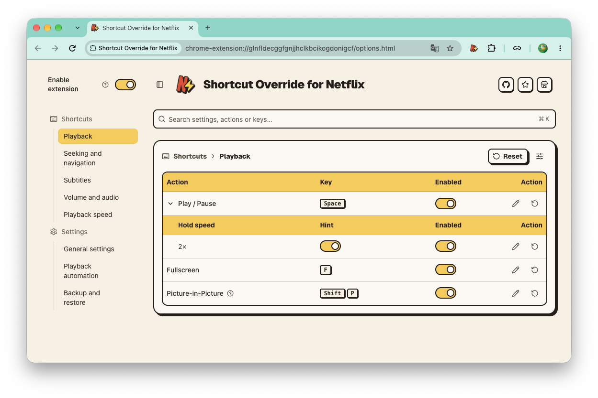

# Shortcut Override for Netflix

[English](../../README.md) · [繁體中文](zh-TW.md) · [简体中文](zh-CN.md) · [日本語](ja.md) · 한국어

[](https://github.com/chenghsj/netflix-shortcut-override/actions/workflows/ci.yml)
[](https://github.com/chenghsj/netflix-shortcut-override/releases/latest)
[](../../LICENSE)

Netflix 재생 단축키를 설정하고, 자막 위치로 이동하거나 자막이 유지되는 화면 속 화면으로 시청하세요.

비공식 확장 프로그램이며 Netflix와 제휴 관계가 없고 Netflix의 승인이나 후원을 받지 않습니다.

[설치](#설치) · [빠른 시작](#빠른-시작) · [단축키](#기본-단축키) · [설정](#설정-및-사용자-지정) · [화면 속 화면](#화면-속-화면) · [백업](#백업-동기화-및-초기화) · [문제 해결](#문제-해결)

## 화면 미리 보기



Neobrutalism 스타일의 설정 화면입니다. Classic 스타일도 제공하며 밝게·어둡게·시스템 테마를 선택할 수 있습니다.

## 설치

[](https://chromewebstore.google.com/detail/shortcut-override-for-net/jebnhiecgnchnioahfagmnebdknddbom)
[](https://microsoftedge.microsoft.com/addons/detail/shortcut-override-for-net/ddfnieehcebicbmnejlafjphppdjmdhi)
[](https://addons.mozilla.org/firefox/addon/70ea1dc7212746bd96bd/)

브라우저 스토어에서 설치한 뒤 Netflix 동영상을 여세요. 도구 모음의 확장 프로그램 아이콘을 누르면 상태를 확인하거나 설정을 열 수 있습니다.

수동으로 설치하려면 [GitHub Releases](https://github.com/chenghsj/netflix-shortcut-override/releases/latest)에서 브라우저에 맞는 패키지를 다운로드하세요.

- **Chrome / Edge:** Chromium ZIP의 압축을 풀고 `chrome://extensions` 또는 `edge://extensions`에서 개발자 모드를 켜세요. 압축 해제된 확장 프로그램을 로드하는 항목을 선택한 뒤 `manifest.json`이 들어 있는 폴더를 지정하세요.
- **Firefox:** `about:debugging#/runtime/this-firefox`에서 임시 부가 기능을 로드하는 항목을 선택하고 Firefox ZIP을 지정하세요. 브라우저를 다시 시작하면 제거됩니다. 계속 사용하고 자동 업데이트를 받으려면 Firefox Add-ons에서 설치하세요.

설치에는 이름에 `chromium` 또는 `firefox`가 포함된 ZIP을 사용하세요. `source` ZIP은 소스 빌드용입니다. 베타는 [릴리스 목록](https://github.com/chenghsj/netflix-shortcut-override/releases)에서 사전 릴리스를 선택하고 [베타 설치 가이드(영어)](../release.md#beta-releases)를 참고하세요. 수동 버전을 테스트할 때는 같은 확장 프로그램의 다른 설치본을 비활성화해 단축키가 중복 처리되지 않도록 하세요. 설정 백업으로 환경설정을 옮길 수 있습니다.

이 README는 현재 소스의 기능을 설명합니다. 스토어 패키지와 안정 버전에는 일부 기능이 없을 수 있으므로 설치한 버전의 릴리스 노트를 확인하세요.

## 빠른 시작

1. Netflix 동영상을 여세요. 확장 프로그램을 설치하거나 다시 로드하기 전부터 열려 있던 탭은 새로고침하세요.
2. 도구 모음 팝업에서 확장 프로그램이 활성화되어 있는지 확인하세요. 기본적으로 켜져 있으며 저장된 단축키와 호환성 상태도 표시됩니다.
3. 팝업을 닫고 동영상을 클릭해 포커스를 돌려주세요. `Space`로 재생/일시정지, `Left` / `Right`로 탐색을 시도할 수 있습니다.
4. 단축키 카테고리에서 설정 열기를 선택해 키와 환경설정을 편집하세요. 대부분의 스위치는 즉시 저장되며 편집 대화상자의 변경은 저장을 선택하면 적용됩니다.

일반 단축키와 `2x` 길게 누르기 속도는 기본적으로 켜져 있습니다. 자막 탐색, 자동 건너뛰기, 다음 에피소드 자동 재생, 일시 정지 오버레이 숨기기는 직접 켜야 합니다.

## 주요 기능

- 단축키 변경, 키 할당 해제, 개별 활성화·비활성화, 설정에서 키 충돌 해결.
- 재생, 프레임 이동, 탐색, 에피소드 전환, 음량, 전체 화면, 재생 속도 제어.
- 탐색 단축키 쌍, 동영상 위치(%) 이동, 선호 속도 단축키 추가 및 자막 크기 순환 편집.
- 즐겨찾는 자막 및 오디오 트랙을 지정한 순서로 전환하고 음성 해설 트랙을 별도로 선택.
- 이전·다음 자막으로 이동하거나 현재 자막 다시 재생.
- Chrome과 Edge에서 Netflix 자막과 재생 컨트롤이 포함된 화면 속 화면 사용.
- 재생/일시정지 키를 길게 눌러 일시적으로 속도를 바꾸고, 놓으면 원래 속도로 복원.
- 인트로·지난 이야기 자동 건너뛰기, 다음 에피소드 자동 재생, 일시 정지 오버레이 숨기기.
- 도구 모음 팝업에서 호환성 확인 및 로컬 진단 정보 복사.
- 브라우저 저장소를 통한 설정 동기화, 백업 내보내기·가져오기, 5개 인터페이스 언어와 3가지 스타일 지원.

## 기본 단축키

현재 설정 화면의 다섯 카테고리에 따라 내장 동작 23개를 모두 표시합니다. 재생 키는 변경하거나 비활성화할 수 있습니다. 업그레이드는 저장된 할당을 유지하므로 현재 키는 팝업에서 확인하세요.

### 재생

| 동작 | 기본 키 | 작동 방식 |
| --- | --- | --- |
| 재생 / 일시정지 | `Space` | 짧게 눌러 재생/일시정지, 길게 눌러 임시 배속 적용. |
| 이전 에피소드 | `Shift + P` | Netflix 에피소드 목록에서 이전의 사용 가능한 회차 재생. |
| 다음 에피소드 | `Shift + N` | Netflix 다음 에피소드 컨트롤 또는 목록 사용. |
| 전체 화면 | `F` | Netflix 페이지의 전체 화면 전환. PiP 안에서는 사용 불가. |
| 화면 속 화면 | `P` | 자막을 유지하는 PiP 열기/닫기. Chrome/Edge 116 이상 필요. |

### 재생 위치 및 탐색

| 동작 | 기본 키 | 작동 방식 |
| --- | --- | --- |
| 이전 프레임 | `,` | 일시정지 후 한 프레임 뒤로 이동하고 정지 유지. |
| 다음 프레임 | `.` | 일시정지 후 한 프레임 앞으로 이동하고 정지 유지. |
| 인트로 건너뛰기 | `S` | 인식 가능한 Netflix 건너뛰기 버튼 클릭. 인트로·지난 이야기·크레딧 포함. |
| 빨리감기 | `→` | 기본 10초 앞으로 이동. 내장 간격은 1–300초. |
| 되감기 | `←` | 앞으로 이동과 같은 간격만큼 뒤로 이동. |

### 자막 언어 및 크기

| 동작 | 기본 키 | 작동 방식 |
| --- | --- | --- |
| 자막 켜기/끄기 | `C` | Netflix 자막 켜기/끄기. 사용 가능하면 이전 트랙 복원. |
| 자막 크기 전환 | `Shift + C` | 80% → 100% → 125% 순환. 초기값은 100%이며 첫 입력은 125%. |
| 다음 자막 언어 | `Shift + X` | 다음 사용 가능한 자막/즐겨찾기로 전환하고 끝에서 순환. |
| 이전 자막 언어 | `Shift + Z` | 이전 사용 가능한 자막/즐겨찾기로 전환하고 처음에서 순환. |

### 음량 및 오디오

| 동작 | 기본 키 | 작동 방식 |
| --- | --- | --- |
| 볼륨 올리기 | `↑` | 음량을 5퍼센트포인트 높임. |
| 볼륨 내리기 | `↓` | 음량을 5퍼센트포인트 낮춤. |
| 음소거 | `M` | 음소거 전환. |
| 이전 오디오 언어 | `Shift + A` | 이전 오디오/즐겨찾기로 전환. 음성 해설 버전 포함. |
| 다음 오디오 언어 | `Shift + D` | 다음 오디오/즐겨찾기로 전환. 음성 해설 버전 포함. |

### 재생 속도

| 동작 | 기본 키 | 작동 방식 |
| --- | --- | --- |
| 재생 속도 올리기 | `Shift + .` | 기본 0.25x 높임. 설정된 속도 범위 내에서 변경. |
| 재생 속도 내리기 | `Shift + ,` | 기본 0.25x 낮춤. 설정된 속도 범위 내에서 변경. |
| 재생 속도 초기화 | `Shift + /` | 1x로 복원. |
| 자주 쓰는 배속 적용 | `Shift + Quote` | 설정된 선호 속도 적용. 기본 1.5x. |

재생/일시정지 키를 약 250밀리초 누르면 길게 누르기 속도(기본 `2x`)를 적용하고, 놓으면 이전 속도와 재생/정지 상태를 복원합니다. 키를 변경해도 동일합니다. 탐색과 프레임 이동은 길게 누르면 반복하며 정확한 프레임은 Netflix에 따라 달라집니다. 트랙, 자막 크기, 선호 속도, 위치(%), 에피소드 키는 누를 때마다 한 번 동작합니다.

물리적 키 위치와 보조 키로 판별합니다. `Quote`는 따옴표 키(미국 배열의 `'` / `"`)이며 팝업에 `Shift + "`로 표시될 수 있습니다. 별도로 켜는 네 개의 [자막 이동 키](#자막-탐색)와 [설정](#설정-및-사용자-지정)에서 추가하는 키도 있습니다.

### 설정 화면 단축키

확장 프로그램 화면에서 사용하는 키로, 변경 가능한 Netflix 재생 키와 별개입니다.

| 동작 | macOS | Windows / Linux |
| --- | --- | --- |
| 설정 또는 팝업 검색란에 포커스 | `⌘ + K` | `Ctrl + K` |
| 사이드바 순서대로 설정 페이지 전환 | `⌘ + 1`–`⌘ + 9` | `Ctrl + 1`–`Ctrl + 9` |

설정의 1–9는 재생, 재생 위치 및 탐색, 자막, 음량 및 오디오, 재생 속도, 일반 설정, 재생 환경설정, 백업 및 복원, 사용 안내 순서입니다. `⌘` / `Ctrl`을 약 300밀리초 누르면 번호 힌트가 표시됩니다. `Esc`는 검색을 지웁니다. 편집 대화상자 및 키 기록 중에는 페이지를 전환하지 않습니다.

## 설정 및 사용자 지정

설정 사이드바의 백업 및 복원 아래에 있는 **사용 안내** 또는 팝업 하단 버튼을 선택하면 5개 언어로 검색하고 펼치거나 접을 수 있는 안내를 볼 수 있습니다. 11개의 간결한 설명을 시작하기, 단축키 설정, 백업 및 복원, 권한 및 개인정보의 4개 카테고리로 나누고 관련 설정 링크를 제공합니다. 각 기능의 도움말은 해당 컨트롤 옆에 표시됩니다. 전체 기능 설명은 [자세한 사용 가이드(영어)](../user-guide.md)를 참고하세요.

설정 사이드바에서 단축키 카테고리, 일반 설정, 재생 환경설정, 백업 및 복원을 선택하세요. 설정, 기능 이름, 언어 이름 또는 키를 5개 인터페이스 언어로 검색할 수 있습니다. 도구 모음 팝업에서는 단축키를 검색하고 호환성 상태를 확인할 수 있으며, 설정 열기를 선택하면 해당 설정 페이지에서 편집할 수 있습니다.

- **재생 위치 이동:** 내장 및 사용자 지정 탐색 쌍을 모두 1–300초로 설정하고 양방향 키를 따로 지정할 수 있습니다. 동영상의 0–100% 위치 이동 키도 추가할 수 있습니다. 기존에 300초를 넘던 쌍은 업그레이드 시 키를 유지한 채 300초로 조정됩니다.
- **자막 크기:** 기본 80% → 100% → 125% 순환을 50–300%의 서로 다른 정수 크기 2–6개로 편집하고 드래그로 순서를 바꿀 수 있습니다. 100%는 원래 크기이며 로컬 표시만 조절하고 Netflix 계정 설정은 변경하지 않습니다. 일반 재생과 화면 속 화면의 크기는 별도로 저장됩니다. 이전에 저장한 더 긴 순환은 유지되며 고정 크기 및 추가 순환 단축키도 계속 편집하거나 삭제할 수 있습니다.
- **재생 속도:** `0.25x`–`5x`의 선호 속도 단축키를 추가하고 속도와 키를 함께 편집할 수 있습니다. 길게 누르기 속도는 재생/일시정지 아래에, 속도 한도와 변경 간격은 재생 속도 페이지에 있습니다.
- **즐겨찾는 자막 및 오디오:** 자막 언어나 오디오 트랙을 한 번에 추가하고 드래그로 전환 순서를 지정할 수 있습니다. 음성 해설 트랙은 별도로 선택할 수 있습니다. 사용할 수 없는 즐겨찾기는 건너뛰며, 목록이 비어 있으면 사용 가능한 모든 트랙을 전환합니다. 즐겨찾기는 단축키로 전환할 때 적용되며 동영상을 열 때 트랙을 자동으로 변경하지 않습니다.
- **페이지 기능:** 이 페이지 기능 관리에서 필요 없는 항목을 숨기고 해당 단축키를 비활성화하면서 키와 설정값을 유지할 수 있습니다. 다시 표시하면 키 충돌이 없는 단축키가 활성화됩니다. 편집기에서 키를 지운 뒤 미설정 상태로 저장할 수도 있습니다.
- **외관:** Classic 또는 Neobrutalism을 밝게·어둡게·시스템 테마 설정과 독립적으로 선택할 수 있습니다. 기존·가져온 Markdown 설정은 다른 스타일로 바꾸기 전까지 올바르게 적용되고 표시됩니다.

추가 탐색 쌍, 위치(%), 선호 속도는 처음에는 비어 있고 기본 키가 없습니다. 추가할 때 할당하세요. 길게 누르기 속도는 재생/일시정지 키를 공유합니다. 자동 건너뛰기와 다음 에피소드 자동 재생은 추가 키 대신 스위치로 설정합니다.

재생 환경설정의 자동 재생 및 건너뛰기에서 인트로, 지난 이야기, 다음 에피소드를 각각 활성화할 수 있습니다. Netflix가 해당 버튼을 표시하면 자동으로 클릭합니다. 재생 환경설정의 일시 정지 화면에 있는 일시 정지 오버레이 숨기기는 제목, 줄거리와 어두운 배경을 숨기고 자막 및 재생 컨트롤은 표시합니다. 이 옵션들은 모두 기본적으로 꺼져 있습니다.

### 키 편집 및 충돌 해결

행의 연필을 선택하고 키 조합을 입력한 뒤 저장하세요. 단축키 추가로 기존 키를 유지하면서 다른 조합을 추가할 수 있으며, 동작마다 최대 세 개를 설정할 수 있습니다. 키는 개별적으로 제거할 수 있고 저장할 때 빈 필드는 제외하며 남은 첫 키를 기본 키로 사용합니다. 미설정으로 만들려면 모든 키를 지우거나 제거한 뒤 저장하세요.

다른 활성 동작이 사용 중인 키는 다른 조합을 선택하거나 명시적으로 할당을 이전하세요. 이전하면 기존 동작이 비활성화되며 탐색 쌍에 속하면 양방향 모두 비활성화됩니다. 같은 동작의 모든 키는 활성 상태를 공유합니다. 비활성 행은 전체 키 목록을 유지하고 다른 동작이 키를 재사용할 수 있습니다. 설정, 팝업, 검색과 백업에는 할당된 모든 키가 포함됩니다.

브라우저가 기록 필드에 미디어 키 이벤트를 전달하면 `Shift+N`에 `MediaTrackNext`, `Shift+P`에 `MediaTrackPrevious`를 추가할 수 있습니다. 재생 중에는 할당된 트랙 키를 브라우저 Media Session 컨트롤을 통해서도 처리합니다. 운영체제나 브라우저가 가로채는 키는 기록하지 못할 수 있습니다.

할당된 재생/일시정지, 정지, 빨리 감기와 되감기 키도 브라우저 Media Session 컨트롤을 지원합니다. 재생/일시정지 기능에 할당하면 재생 명령은 재생하고, 일시정지 또는 정지 명령은 일시정지만 하며 길게 누르기 속도를 시작하지 않습니다. 할당되지 않은 컨트롤은 Netflix가 처리합니다. 음량 키에는 여전히 키보드 이벤트가 필요합니다.

브라우저가 전체 키보드 이벤트를 전달하면 미디어 키에 Ctrl, Alt, Shift 또는 Command/Win을 조합할 수 있습니다. `Ctrl+MediaTrackNext`와 `MediaTrackNext` 단독 입력은 서로 다른 단축키입니다. 같은 입력에서 키보드 알림과 미디어 알림이 함께 오면 실제로 누른 조합만 실행합니다. 확장 프로그램이 처리하는 브라우저 단독 컨트롤은 모두 최대 120ms 기다린 뒤 단독 키 할당이나 Netflix의 처리를 사용하며, 조합 키를 추측하지 않습니다. 키보드 입력은 즉시 정확한 할당을 선택합니다. 이전 재생 동작은 더 최신 미디어 알림의 기능이 확인될 때까지 기다릴 수 있으며, 단독 키만 설정했더라도 할당되지 않은 조합이 그 기능을 실행하지 않습니다.

재생/일시정지나 빨리 감기 등 지원되는 Netflix 기본 단축키를 변경하면 동작이 활성 상태이고 키가 하나 이상 할당되어 있으며 목록에 원래 키가 남아 있지 않을 때만 원래 Netflix 키가 차단됩니다. 동작을 끄거나 모든 키를 지우거나 확장 프로그램을 끄면 이 차단이 해제됩니다.

예를 들어 90초 탐색 쌍, 동영상 50% 위치 이동, `1.25x`와 `2x`의 개별 속도 키를 추가할 수 있습니다. 사용자 지정 항목은 각각 편집·비활성화·삭제할 수 있습니다.

### 재생 속도 기본값

| 설정 | 기본값 | 설정 범위 |
| --- | --- | --- |
| 최저 속도 | `0.25x` | `0.25x`–`1x` |
| 최고 속도 | `3x` | `1x`–`5x` |
| 변경 간격 | `0.25x` | `0.05x`–`5x` |
| 선호 속도 | `1.5x` | `0.25x`–`5x` |
| 길게 누르기 속도 | `2x` | `0.25x`–`5x` |

속도는 `0.05x` 단위입니다. 길게 누르기 속도와 힌트는 각각 켜고 끌 수 있습니다. 길게 누르는 중 다른 속도 단축키를 사용하면 재생/일시정지 키를 놓아도 새 속도를 유지합니다. 속도 초기화는 `1x`로 돌아갑니다.

속도 높이기 키로 `5x`까지 사용하려면 재생 속도의 범위 및 조정 폭에서 최고 배속을 `5x`로 설정하세요. 바로 `5x`를 적용하려면 기본 선호 속도를 편집하거나 새 속도 단축키를 추가한 뒤 속도와 키를 함께 저장하세요.

## 자막 탐색

자막 탐색은 **기본적으로 꺼져 있습니다**.

1. 설정을 열고 확장 프로그램을 활성화하세요.
2. 단축키의 자막 페이지에서 문장 이동 및 반복 섹션의 활성화 스위치를 켜세요. 브라우저가 요청하면 Netflix와 자막 사이트 접근을 허용하세요.
3. Netflix에서 자막 트랙을 선택하세요.

| 동작 | 기본 키 | 작동 방식 |
| --- | --- | --- |
| 이전 자막 | `A` | 이전 자막 시작으로 이동하고 재생/정지 상태 유지. |
| 다음 자막 | `D` | 다음 자막 시작으로 이동하고 재생/정지 상태 유지. |
| 현재 자막 다시 재생 | 미설정 (기본 비활성화) | 키를 할당하고 켜면 현재 자막 시작에서 한 번 재생. |
| 재생/일시정지 | `W` | 길게 누르기 속도 없이 즉시 재생 상태 전환. |

`A`와 `D`는 현재 재생 또는 일시정지 상태를 유지합니다. 현재 자막 다시 재생은 현재 자막의 시작 위치에서 재생하며 반복하거나 자막 끝에서 자동으로 멈추지 않습니다. `W`는 재생 상태를 즉시 전환하고 길게 누르기 속도를 적용하지 않습니다.

**자막 탐색은 일반 단축키를 덮어쓰지 않습니다.** 사용 중인 키는 다른 키로 바꾸거나 충돌 대화상자에서 명시적으로 할당을 이전하세요. 기존 중복 설정에서는 일반 단축키가 유지되며, 다시 할당할 때까지 `S`로 인트로를 건너뜁니다.

사이트 접근을 거부하면 기능은 꺼진 상태로 유지됩니다. 다시 켜서 권한을 요청할 수 있습니다. 이 키들은 Chrome과 Edge에서 확장 프로그램이 관리하는 화면 속 화면 창에서도 사용할 수 있습니다.

시간 정보는 현재 동영상과 자막 트랙에 맞춰 필요할 때 불러옵니다. 첫 이동 시 로딩 힌트가 표시될 수 있으며 에피소드나 자막 트랙이 바뀌면 다시 불러옵니다. 선택된 자막을 사용하고 언어를 바꾸지 않습니다.

## 화면 속 화면

Chrome 또는 Edge 116 이상에서 Netflix 동영상을 열고 `P`를 누르면 자막이 유지되는 PiP로 전환합니다. 다시 누르거나 창을 닫으면 동영상을 Netflix로 돌려보냅니다. 원본 탭은 열어 두세요.

- 떠 있는 창의 크기를 바꿔도 동영상 비율을 유지합니다.
- 동영상 클릭으로 재생/일시정지하고 컨트롤로 탐색·음소거·음량 조절을 할 수 있습니다. 타임라인 클릭과 드래그도 지원합니다. 포인터를 3초 동안 움직이지 않으면 컨트롤이 숨겨집니다.
- 자막 메뉴는 Netflix 자막 켜기/끄기와 동기화되며 크기와 배경 없음·반투명·어두운 배경을 선택할 수 있습니다. 현재 선택한 Netflix 자막을 표시합니다.
- PiP 동영상에 포커스가 있으면 재생 단축키와 활성화된 자막 탐색 키도 작동합니다. 전체 화면은 원본 Netflix 페이지에서 사용하세요.
- 에피소드 전환이 확인되면 PiP를 닫고 Netflix로 재생을 돌려보냅니다. 다음 에피소드에서 PiP를 다시 여세요.

Firefox 내장 PiP는 별도 기능입니다. 이 확장 프로그램의 PiP 단축키와 자막 컨트롤은 Firefox에서 비활성화됩니다.

## 백업, 동기화 및 초기화

설정은 브라우저 동기화 저장소에 저장됩니다. 기기 간 동기화는 브라우저 계정과 동기화 설정에 따라 달라집니다. 브라우저, 프로필, 스토어/수동 설치본 사이에서는 JSON 백업으로 옮길 수 있습니다.

1. 설정의 백업 및 복원 페이지에서 내보내기를 선택하면 키, 활성 상태, 사용자 지정 항목, 즐겨찾기, 외관, 재생 환경설정을 담은 JSON 파일이 다운로드됩니다.
2. 대상 설치본에서 가져오기를 선택하고 파일을 지정하세요.
3. 요약을 확인하고 확정하세요. 가져오기는 현재 설정을 **교체합니다**. 지원되는 이전 백업은 변환되며 잘못된 파일이나 지원되지 않는 새 형식은 교체 전에 거부됩니다. 되돌릴 수 있도록 대상 설정을 먼저 내보내세요.

초기화 범위는 컨트롤마다 다릅니다.

- **기본값으로 복원:** 백업 및 복원 페이지에서 확인하면 사용자 지정 단축키, 즐겨찾기, 숨긴 기능, 언어, 테마와 인터페이스 스타일을 포함한 모든 설정을 초기화합니다. 보관할 설정은 먼저 백업으로 내보내세요.
- **일반 단축키 초기화:** 일반 키와 활성 상태를 복원하고 추가한 탐색·선호 속도·자막 크기 항목을 제거하며 자막 크기 순환을 복원합니다. 자막 탐색 키와 다른 환경설정은 유지합니다.
- **자막 탐색 초기화:** 네 행을 복원하고 마스터 스위치는 유지합니다. 활성 일반 단축키가 이미 사용하는 기본 키의 행은 비활성 상태가 됩니다.
- 개별 초기화는 탐색 간격만, 속도 범위와 변경 간격만, 길게 누르기 설정만 등 대상이 좁습니다. 확정 전에 설명을 확인하세요.

## 인터페이스 언어

영어, 번체 중국어, 간체 중국어, 일본어, 한국어를 지원합니다. 지원되는 브라우저 인터페이스 언어를 자동으로 따르거나 설정에서 직접 선택할 수 있습니다.

## 지원 브라우저 및 제한 사항

- 데스크톱 Chrome 111 이상, Edge 111 이상, Firefox 128 이상을 지원합니다. 자막을 유지하는 화면 속 화면 기능은 Chrome 또는 Edge 116 이상이 필요하며 Firefox에서는 비활성화됩니다.
- 단축키는 Netflix 시청 페이지 또는 플레이어가 표시된 페이지에서 작동합니다. 편집 가능한 입력란에서 입력할 때는 키를 가로채지 않습니다.
- 전체 화면은 Netflix 페이지에서만 사용할 수 있습니다. 인트로 건너뛰기는 Netflix 건너뛰기 버튼이 표시되어야 작동합니다.
- 탐색, 자막 전환, 자막 탐색은 Netflix의 비공개 플레이어 인터페이스에 의존하므로 Netflix 변경 시 확장 프로그램 업데이트가 필요할 수 있습니다.

## 권한 및 개인정보

- **Netflix 사이트 접근:** 재생 단축키를 실행하고 현재 선택된 자막 트랙을 읽습니다.
- **선택적 `https://*.nflxvideo.net/*` 접근:** 자막 탐색을 켤 때 권한을 요청하고 탐색 동작 시 자막 문서를 다운로드합니다. 이 CDN 사이트에서는 콘텐츠 스크립트를 실행하지 않습니다.
- **저장소, 스크립트 실행, 활성 탭:** 설정 저장, 재생 동작 실행, 호환성 확인, 재생 화면으로 포커스 복원에 사용됩니다. 팝업은 사용자가 복구 동작을 선택한 경우에만 Netflix를 새로고침합니다.

자막 탐색을 꺼도 이미 허용한 사이트 접근 권한은 취소되지 않습니다. [권한 설명(영어)](../user-guide.md#permissions)과 [사이트 접근 문제 해결(영어)](../troubleshooting.md#subtitle-website-access)을 참고하세요.

사용 통계 수집, 추적 또는 제삼자 처리 서비스를 사용하지 않습니다. 자막 문서는 Netflix 배포 호스트에서 받아 로컬에서 분석하며 시간 정보 캐시는 메모리에만 유지됩니다. 설정은 브라우저 동기화 저장소를 사용합니다. 호환성 진단 정보는 직접 복사해 공유하지 않는 한 기기에 남습니다. 전체 내용은 [개인정보 처리방침(영어)](../../PRIVACY.md)을 참고하세요.

## 문제 해결

- **키가 작동하지 않음:** 전체 및 개별 동작 스위치를 확인하고 팝업을 닫은 뒤 동영상에 포커스를 주세요. 입력란에서는 키를 가로채지 않습니다. 현재 키는 팝업에서 확인하세요.
- **비활성 또는 확인 중 표시:** Netflix 새로고침이 제공되면 사용할 수 있습니다. 동영상 로딩 중에는 호환성을 자동으로 다시 확인하므로 플레이어 준비를 기다리세요.
- **자막 탐색 로딩 실패:** Netflix 자막 트랙을 선택하고 자막 탐색을 껐다 켜 사이트 접근을 다시 요청하세요. Firefox에서는 확장 프로그램의 권한 및 데이터 페이지도 확인하세요.
- **즐겨찾기가 건너뛰어짐:** 현재 동영상에 해당 트랙이 있어야 합니다. 일치하는 트랙이 없으면 선택은 유지됩니다. 목록을 비우면 사용 가능한 모든 트랙을 전환합니다.
- **PiP 사용 불가:** Chrome/Edge 116 이상에서 실제 재생 동영상을 여세요. 이 확장 프로그램의 PiP는 Firefox에서 비활성화됩니다.

권한 복구와 개발 문제는 [문제 해결 가이드(영어)](../troubleshooting.md)를 참고하세요. 플레이어나 API 문제를 보고할 때는 팝업의 호환성 진단 정보를 첨부하세요.

## 개발 및 문서

Node.js 22.18.0 이상과 npm이 필요합니다. 저장소 루트에서 실행하세요.

```sh
npm ci
npm run build
```

Chrome / Edge에서는 `dist/chromium`을 로드하고, Firefox에서는 `dist/firefox/manifest.json`을 임시 부가 기능으로 로드하세요.

`npm run build`는 타입 검사, 두 브라우저용 빌드, 생성된 백그라운드 진입점 검증을 수행합니다. Chromium 개발 시 `npm run dev`를 실행하고 `dist/chromium` 대신 `dist`를 로드한 뒤 HMR 서버를 켜 두세요. manifest, 백그라운드 또는 콘텐츠 스크립트 등록을 변경하면 확장 프로그램과 Netflix 탭을 다시 로드하세요.

자동 검사:

```sh
npm run lint
npm run test:coverage
npm run build
npm run lint:firefox
```

자동 검사는 제어된 브라우저·플레이어 대체 환경을 사용합니다. 실제 Netflix 재생, 권한, 에피소드 전환은 아래 브라우저 검증 가이드로도 확인하세요.

상세 문서는 영어로 유지합니다.

- [사용 가이드](../user-guide.md): 설정, 자막 탐색, 권한 및 개인정보 세부 사항.
- [개발 가이드](../development.md): HMR, 명령어, 구조 및 테스트.
- [설정 업그레이드 확인](../settings-upgrade.md): 설정 마이그레이션, 백업 호환성, 설치된 브라우저 검증.
- [출시 가이드](../release.md): 버전 태그, 패키징, 체크섬 및 Firefox 제출.
- [문제 해결](../troubleshooting.md): 단축키, 사이트 권한 및 개발 문제.
- [동작 명세](../behavior-spec.md) · [Chrome 브라우저 테스트](../chrome-real-browser-test.md) · [Firefox 브라우저 테스트](../firefox-real-browser-test.md)

## 문제 보고 및 라이선스

[GitHub issue](https://github.com/chenghsj/netflix-shortcut-override/issues/new/choose)에 브라우저와 확장 프로그램 버전, 실패한 동작, 가능한 경우 도구 모음 팝업에서 복사한 호환성 진단 정보를 포함하세요.

[MIT 라이선스](../../LICENSE)를 따릅니다.
