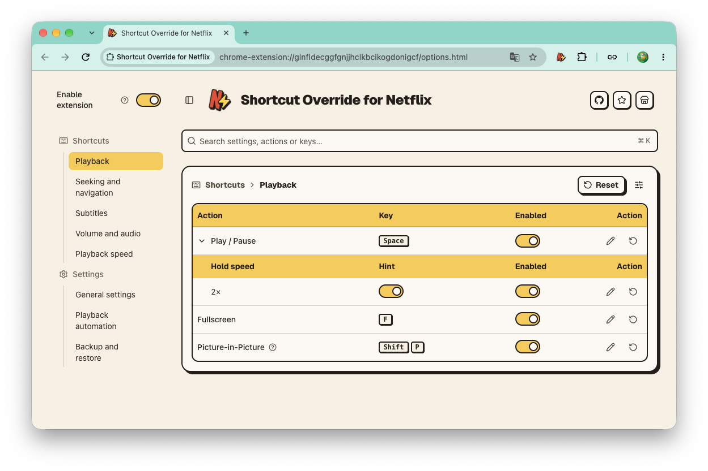

# Shortcut Override for Netflix

[English](../../README.md) · 繁體中文 · [简体中文](zh-CN.md) · [日本語](ja.md) · [한국어](ko.md)

[](https://github.com/chenghsj/netflix-shortcut-override/actions/workflows/ci.yml)
[](https://github.com/chenghsj/netflix-shortcut-override/releases/latest)
[](../../LICENSE)

自訂 Netflix 播放快捷鍵、依字幕跳轉，並使用保留字幕的子母畫面。

本專案為非官方擴充功能，與 Netflix 無關，亦未獲其背書或贊助。

[安裝](#安裝) · [快速開始](#快速開始) · [快捷鍵](#預設快捷鍵) · [設定](#設定與自訂) · [子母畫面](#子母畫面) · [備份](#備份同步與重設) · [疑難排解](#疑難排解)

## 介面預覽



圖為 Neobrutalism 風格的設定頁。另提供 Classic、Markdown 風格，並可選擇淺色、深色或跟隨系統。

## 安裝

[](https://chromewebstore.google.com/detail/shortcut-override-for-net/jebnhiecgnchnioahfagmnebdknddbom)
[](https://microsoftedge.microsoft.com/addons/detail/shortcut-override-for-net/ddfnieehcebicbmnejlafjphppdjmdhi)
[](https://addons.mozilla.org/firefox/addon/70ea1dc7212746bd96bd/)

從瀏覽器商店安裝後，開啟 Netflix 影片，點選工具列的擴充功能圖示，即可查看狀態或開啟設定。

手動安裝可從 [GitHub Releases](https://github.com/chenghsj/netflix-shortcut-override/releases/latest) 下載對應瀏覽器的套件：

- **Chrome／Edge：**解壓縮 Chromium ZIP，在 `chrome://extensions` 或 `edge://extensions` 開啟開發人員模式，選擇「載入未封裝項目」，再選取包含 `manifest.json` 的資料夾。
- **Firefox：**開啟 `about:debugging#/runtime/this-firefox`，選擇「載入暫時附加元件」，再選取 Firefox ZIP。此方式在瀏覽器重啟後失效；永久安裝與自動更新請使用 Firefox Add-ons。

安裝請選擇檔名含 `chromium` 或 `firefox` 的 ZIP；`source` ZIP 用於自行建置。測試版請至[版本列表](https://github.com/chenghsj/netflix-shortcut-override/releases)選擇預發行版本，並參閱[測試版安裝指南（英文）](../release.md#beta-releases)。測試手動安裝版本時，請先停用另一份同名擴充功能，避免重複處理快捷鍵；可透過設定備份搬移偏好。

本 README 說明目前原始碼的功能。商店套件與穩定版可能尚未包含部分功能，請對照安裝版本的更新說明。

## 快速開始

1. 開啟 Netflix 影片。若安裝或重新載入擴充功能時 Netflix 已開啟，請重新整理該分頁。
2. 開啟工具列彈出視窗，確認「啟用擴充功能」已開啟；此開關預設開啟，也可在此查看目前快捷鍵與相容性狀態。
3. 關閉彈出視窗，點一下影片讓播放器取得焦點，再試按 `Space` 播放／暫停，或 `Left`／`Right` 跳轉。
4. 從快捷鍵分類點選「開啟設定」，即可編輯該頁按鍵與偏好。多數開關立即儲存；編輯對話框則在按下「儲存」後套用。

一般快捷鍵與 `2x` 長按變速預設啟用。字幕導航、自動略過、自動播放下一集與隱藏暫停遮罩需自行開啟。

## 主要功能

- 自訂快捷鍵、清空按鍵、個別啟用或停用，並在設定中處理按鍵衝突。
- 控制播放、逐幀移動、快轉與倒轉、切換集數、音量、全螢幕及播放速度。
- 新增前進／後退組合、影片百分比跳轉與常用倍速快捷鍵，並自訂字幕大小循環。
- 依自訂順序切換常用字幕與音軌，並可分別選擇口述影像音軌。
- 跳至上一句或下一句字幕，或重播目前句子。
- 在 Chrome 與 Edge 使用保留 Netflix 字幕、附播放控制的子母畫面。
- 長按播放／暫停鍵暫時調整速度，放開後恢復原速。
- 自動略過片頭、前情提要或播放下一集，並可隱藏 Netflix 暫停遮罩。
- 透過工具列彈出視窗檢查相容性，並複製本機診斷資訊。
- 透過瀏覽器儲存空間同步設定、匯出與匯入備份，並提供五種介面語言與三種介面風格。

## 預設快捷鍵

以下依目前設定頁的五個分類，列出全部 23 個內建動作。播放快捷鍵皆可改鍵或停用；升級會保留已儲存的按鍵，目前設定請以彈出視窗為準。

### 播放

| 動作 | 預設按鍵 | 行為 |
| --- | --- | --- |
| 播放 / 暫停 | `Space` | 短按切換播放／暫停；長按暫時變速。 |
| 全螢幕 | `F` | 切換 Netflix 頁面的全螢幕；子母畫面內不適用。 |
| 子母畫面 | `Shift + P` | 開啟／關閉保留字幕的子母畫面，需 Chrome／Edge 116+。 |

### 進度與跳轉

| 動作 | 預設按鍵 | 行為 |
| --- | --- | --- |
| 上一幀 | `,` | 先暫停，再倒退一幀，移動後保持暫停。 |
| 下一幀 | `.` | 先暫停，再前進一幀，移動後保持暫停。 |
| 略過片頭 | `S` | 點選目前可見且能辨識的 Netflix 略過按鈕，包含片頭、前情提要或片尾。 |
| 上一集 | `Ctrl + P` | 透過 Netflix 集數選單播放前一個可用集數。 |
| 下一集 | `Ctrl + N` | 使用 Netflix 的下一集控制或集數選單。 |
| 快轉 | `→` | 預設前進 10 秒；內建組合可設為 1–300 秒。 |
| 倒轉 | `←` | 後退與前進相同的秒數。 |

### 字幕切換與大小

| 動作 | 預設按鍵 | 行為 |
| --- | --- | --- |
| 開啟／關閉字幕 | `C` | 開關 Netflix 原生字幕，重新開啟時還原上次仍可用的字幕軌。 |
| 切換字幕大小 | `Shift + C` | 依 80% → 100% → 125% 循環；初始為 100%，第一次按下切至 125%。 |
| 切換到下一個字幕語言 | `Shift + X` | 切換下一個可用字幕／常用語言，到尾端後循環。 |
| 切換到上一個字幕語言 | `Shift + Z` | 切換上一個可用字幕／常用語言，到開頭後循環。 |

### 音量與音軌

| 動作 | 預設按鍵 | 行為 |
| --- | --- | --- |
| 提高音量 | `↑` | 每次提高 5 個百分點。 |
| 降低音量 | `↓` | 每次降低 5 個百分點。 |
| 靜音 | `M` | 切換靜音狀態。 |
| 上一種音軌語言 | `Shift + A` | 切換上一種可用音軌／常用音軌，包含口述影像版本。 |
| 下一種音軌語言 | `Shift + D` | 切換下一種可用音軌／常用音軌，包含口述影像版本。 |

### 播放速度

| 動作 | 預設按鍵 | 行為 |
| --- | --- | --- |
| 加快播放速度 | `Shift + .` | 預設每次提高 0.25x，受設定的速度上下限限制。 |
| 降低播放速度 | `Shift + ,` | 預設每次降低 0.25x，受設定的速度上下限限制。 |
| 重設播放速度 | `Shift + /` | 回到 1x。 |
| 套用常用倍速 | `Shift + Quote` | 套用設定的常用倍速，預設為 1.5x。 |

長按播放／暫停鍵約 250 毫秒會套用長按速度（預設 `2x`），放開後還原原本速度與播放／暫停狀態；改鍵後也會跟隨新的播放／暫停鍵。長按跳轉或逐幀鍵可重複移動，逐幀精確度取決於 Netflix。切換軌道、字幕大小循環、常用倍速、百分比跳轉與切換集數皆為每次按下執行一次。

macOS 的 `Ctrl + P`／`Ctrl + N` 同樣指 Control，可能被瀏覽器保留，必要時請改鍵。快捷鍵以實體按鍵位置與修飾鍵判定；`Quote` 指引號鍵（美式鍵盤的 `'`／`"`），彈出視窗可能顯示為 `Shift + "`。另有四個需獨立啟用的[逐句字幕動作](#字幕導航)，以及可在[設定](#設定與自訂)新增的自訂快捷鍵。

### 設定介面快捷鍵

以下用於擴充功能介面，與可自訂的 Netflix 播放按鍵分開。

| 動作 | macOS | Windows／Linux |
| --- | --- | --- |
| 聚焦設定頁或彈出視窗的搜尋欄 | `⌘ + K` | `Ctrl + K` |
| 依側邊欄順序切換設定頁 | `⌘ + 1`–`⌘ + 9` | `Ctrl + 1`–`Ctrl + 9` |

設定頁的 1–9 依序為播放、進度與跳轉、字幕、音量與音軌、播放速度、一般設定、自動播放與略過、備份與還原、使用說明。長按 `⌘`／`Ctrl` 約 300 毫秒會顯示側邊欄數字提示；`Esc` 可清除搜尋。編輯對話框及快捷鍵錄製期間不會觸發分類切換。

## 設定與自訂

從設定頁側邊欄選擇快捷鍵分類、一般設定、自動播放與略過，或備份與還原。可跨五種介面語言搜尋設定、功能名稱、語言名稱或按鍵。工具列彈出視窗提供可搜尋的快捷鍵參考與相容性狀態；點選「開啟設定」會進入對應的設定頁編輯。

- **進度與跳轉：**內建與自訂前進／後退組合皆可設為 1–300 秒，兩個方向各自設定按鍵；也可新增跳至影片 0–100% 位置的快捷鍵。升級時，舊有超過 300 秒的自訂組合會調整為 300 秒並保留按鍵。
- **字幕大小：**修改預設的 80% → 100% → 125% 循環，使用 2–6 個不同的 50–300% 整數百分比，並拖曳調整順序。100% 還原原始大小；縮放只在本機套用，不會變更 Netflix 帳號偏好。一般播放與子母畫面分別保存目前大小；先前保存的較長循環會保留，固定大小及額外循環快捷鍵仍可編輯或刪除。
- **播放速度：**新增 `0.25x` 至 `5x` 的常用倍速快捷鍵，同時編輯速度與按鍵。長按倍速位於播放／暫停下方，速度上下限與調整幅度則位於播放速度頁。
- **常用字幕與音軌：**批次加入字幕語言或音軌，再拖曳調整切換順序；口述影像音軌可獨立選取。快捷鍵會略過目前影片未提供的項目；清單為空時則切換所有可用軌道。常用清單只影響快捷鍵切換，開啟影片時不會自動改變軌道。
- **本頁功能：**使用「管理本頁功能」隱藏不需要的控制項並停用對應快捷鍵，同時保留按鍵與參數。重新顯示時，沒有按鍵衝突的快捷鍵會啟用。也可在編輯器中清空按鍵，儲存為「未設定」。
- **外觀：**選擇 Classic、Neobrutalism 或 Markdown 介面風格，並獨立設定淺色、深色或跟隨系統。

自訂前進／後退組合、百分比跳轉與額外常用倍速預設皆為空清單，沒有固定預設按鍵，新增時自行指定。長按變速共用播放／暫停鍵；自動略過與自動播放下一集則使用開關，不另配快捷鍵。

在「自動播放與略過」中，可分別啟用片頭、前情提要或下一集；Netflix 顯示對應按鈕時，擴充功能會自動點選。在「一般設定」啟用「隱藏暫停遮罩」，可隱藏暫停時的節目名稱、簡介與黑色遮罩，保留字幕和播放控制列。這些選項皆預設關閉。

### 改鍵與處理衝突

點選列上的鉛筆，錄製按鍵組合後按「儲存」。若其他已啟用的動作占用按鍵，可改用其他組合，或明確將按鍵轉移給目前動作；轉移會停用原本的擁有者。停用的列保留按鍵，但可供其他動作使用。在編輯器中「清除快捷鍵」後儲存，即可保持未設定。

將播放／暫停、快轉等支援的 Netflix 原生快捷鍵改鍵後，只要該動作啟用，原本的 Netflix 按鍵就會被攔截。停用動作、清空按鍵或關閉擴充功能後，原本按鍵交回 Netflix 處理。

例如可新增 90 秒的前進／後退組合、跳至影片 50% 的按鍵，或分別設定 `1.25x` 與 `2x` 常用倍速鍵。自訂項目可個別編輯、停用或刪除。

### 播放速度預設值

| 設定 | 預設值 | 可設定範圍 |
| --- | --- | --- |
| 最低速度 | `0.25x` | `0.25x`–`1x` |
| 最高速度 | `3x` | `1x`–`5x` |
| 調整幅度 | `0.25x` | `0.05x`–`5x` |
| 常用倍速 | `1.5x` | `0.25x`–`5x` |
| 長按倍速 | `2x` | `0.25x`–`5x` |

速度以 `0.05x` 為單位調整。長按變速與提示可分別切換；長按期間使用其他倍速快捷鍵，放開播放／暫停鍵後會保留新速度。重設播放速度會回到 `1x`。

若要用加快速度鍵調到 `5x`，請在「播放速度 → 範圍與調整幅度」將「最高倍速」設為 `5x`。若要直接套用 `5x`，可編輯內建常用倍速，或新增常用倍速快捷鍵，再一起儲存速度與按鍵。

## 字幕導航

字幕導航**預設關閉**：

1. 開啟設定，打開「啟用擴充功能」。
2. 進入「快捷鍵 → 字幕 → 逐句跳轉與重播」，打開「啟用」，並在瀏覽器提示時允許 Netflix 與字幕來源的網站存取權。
3. 在 Netflix 選擇字幕軌。

| 動作 | 預設按鍵 | 行為 |
| --- | --- | --- |
| 上一句 | `A` | 跳到前一句的開始，保持播放／暫停狀態。 |
| 下一句 | `D` | 跳到下一句的開始，保持播放／暫停狀態。 |
| 重播目前句子 | 未設定（預設停用） | 自行配鍵並啟用後，跳到目前句子的開始並播放一次。 |
| 播放／暫停 | `W` | 立即切換播放狀態，不啟動長按變速。 |

`A`、`D` 保持原本的播放或暫停狀態。重播功能從目前字幕開始播放，不會循環或在句尾自動停止。`W` 立即切換播放狀態，不會啟動長按變速。

**字幕導航不會覆蓋一般快捷鍵。**已啟用的快捷鍵會保留按鍵；請為字幕導航改鍵，或在衝突提示中明確轉移歸屬。既有重複設定會保留一般快捷鍵，`S` 會繼續略過片頭，直到明確重新分配。

拒絕網站授權時，字幕導航會保持關閉；再次開啟即可重試。這些按鍵也可在 Chrome 與 Edge 的擴充功能子母畫面中使用。

時間資訊會在使用時依目前影片與字幕軌載入。第一次跳轉可能顯示載入提示；切換集數或字幕軌後會重新載入。導航使用目前選擇的字幕，不會自行改變語言。

## 子母畫面

在 Chrome 或 Edge 116+ 開啟 Netflix 影片後，按 `Shift + P` 進入保留字幕的子母畫面。再按一次或關閉視窗可將影片放回 Netflix；使用期間請保持來源分頁開啟。

- 可調整浮動視窗大小，影片會保持長寬比。
- 點選影片即可播放／暫停，也可用控制列跳轉、靜音、調整音量，或點選／拖曳進度條。滑鼠停止移動三秒後，控制列會隱藏。
- 字幕選單與 Netflix 的字幕開關同步，並可選擇字幕大小及無背景、半透明或深色背景；顯示內容來自目前選擇的 Netflix 字幕。
- 子母畫面影片取得焦點時，也可使用播放快捷鍵與已啟用的字幕導航鍵；全螢幕則在來源 Netflix 頁面使用。
- 偵測到集數切換後，子母畫面會關閉並回到 Netflix 播放；下一集需再次開啟子母畫面。

Firefox 內建的子母畫面是另一項功能；本擴充功能的子母畫面快捷鍵與字幕控制在 Firefox 中停用。

## 備份、同步與重設

設定儲存在瀏覽器同步空間。跨裝置同步取決於瀏覽器帳號與同步設定；跨瀏覽器、設定檔，或商店與手動安裝版本之間，可使用 JSON 備份搬移。

1. 開啟「設定 → 備份與還原 → 匯出設定」，下載包含按鍵、啟用狀態、自訂項目、常用軌道、外觀與播放偏好的 JSON 檔。
2. 在目標安裝版本選擇「匯入設定」，並選取檔案。
3. 檢查摘要後確認。匯入會**取代**目前設定；支援的舊備份會自動轉換，格式錯誤或不支援的新版檔案會在取代前被拒絕。若需保留還原方式，請先匯出目標端的設定。

各重設控制的範圍不同：

- **重設一般快捷鍵：**還原所有一般快捷鍵的按鍵與啟用狀態，移除自訂跳轉、常用倍速及字幕大小項目，並還原字幕大小循環；字幕導航按鍵及其他偏好維持原值。
- **重設字幕導航：**還原四列快捷鍵並保留主開關；若預設按鍵已被啟用的一般快捷鍵占用，該列會保持停用。
- 個別設定的重設範圍較小，例如只還原跳轉秒數、速度上下限與幅度，或長按變速設定；確認前可查看重設說明。

## 介面語言

支援英文、繁體中文、簡體中文、日文與韓文。可自動跟隨支援的瀏覽器介面語言，或在設定中手動選擇。

## 瀏覽器支援與限制

- 支援桌面版 Chrome 111+、Edge 111+ 與 Firefox 128+。保留字幕的子母畫面需使用 Chrome 或 Edge 116+；Firefox 中此功能停用。
- 快捷鍵只在 Netflix 觀影頁面或顯示播放器的頁面運作；在可編輯欄位輸入時不會攔截按鍵。
- 全螢幕只適用於 Netflix 頁面。略過片頭需有可見的 Netflix 略過按鈕。
- 跳轉、字幕切換與字幕導航依賴 Netflix 未公開的播放器介面，Netflix 更新後可能需要調整擴充功能。

## 權限與隱私

- **Netflix 網站存取權：**執行播放快捷鍵並讀取目前選擇的字幕軌。
- **選用的 `https://*.nflxvideo.net/*` 存取權：**啟用字幕導航時要求授權，使用導航時下載字幕文件；不會在此 CDN 網站執行內容指令碼。
- **儲存空間、指令碼執行及目前分頁：**儲存設定、執行播放操作、檢查相容性及恢復播放焦點。只有選擇復原操作時，彈出視窗才會重新載入 Netflix。

關閉字幕導航不會撤銷已授予的網站存取權。詳見[權限說明（英文）](../user-guide.md#permissions)與[授權疑難排解（英文）](../troubleshooting.md#subtitle-website-access)。

不使用流量分析、追蹤或第三方處理服務。字幕從 Netflix 傳送主機下載並在本機解析，時間快取只留在記憶體；設定使用瀏覽器同步儲存空間。相容性診斷留在裝置上，除非你自行複製並分享。完整政策請見[隱私權政策（英文）](../../PRIVACY.md)。

## 疑難排解

- **按鍵沒有反應：**確認全域與個別動作開關已啟用，關閉彈出視窗並讓影片取得焦點。在文字欄位輸入時不會攔截按鍵；目前按鍵可在彈出視窗查看。
- **顯示未啟用或仍在檢查：**若提供「重新載入 Netflix」，可使用此復原功能。Netflix 尚在載入時，彈出視窗會自動重查相容性，請等待播放器就緒。
- **字幕導航無法載入：**先選擇 Netflix 字幕軌，再關閉並重新開啟字幕導航以重試網站授權。Firefox 也可檢查擴充功能的「權限與資料」頁面。
- **常用軌道被略過：**目前影片必須提供該軌道；全部不符合時會保持原選擇。清空常用清單即可切換所有可用軌道。
- **無法使用子母畫面：**請使用 Chrome／Edge 116+ 並開啟實際播放的影片；本擴充功能的子母畫面在 Firefox 中停用。

授權復原與開發問題請見[疑難排解指南（英文）](../troubleshooting.md)。回報播放器或 API 問題時，可附上彈出視窗的相容性診斷資訊。

## 開發與文件

需 Node.js 22.18.0 以上與 npm。在專案根目錄執行：

```sh
npm ci
npm run build
```

Chrome／Edge 載入 `dist/chromium`；Firefox 以暫時附加元件載入 `dist/firefox/manifest.json`。

`npm run build` 會檢查型別、建置兩種瀏覽器版本，並驗證產出的背景程式進入點。Chromium 開發時執行 `npm run dev`，改為載入 `dist` 並保持 HMR 伺服器運行。修改 manifest、背景程式或內容指令碼註冊後，請重新載入擴充功能與 Netflix 分頁。

自動化檢查：

```sh
npm run lint
npm run test:coverage
npm run build
npm run lint:firefox
```

自動化檢查使用受控的瀏覽器與播放器替身；Netflix 實際播放、授權與集數切換仍需執行下方連結的瀏覽器驗收。

以下詳細文件以英文維護：

- [使用指南](../user-guide.md)：設定、字幕導航、權限與隱私細節。
- [開發指南](../development.md)：HMR、指令、架構與測試。
- [設定升級檢查](../settings-upgrade.md)：設定遷移、備份相容性與已安裝瀏覽器驗證。
- [發布指南](../release.md)：版本標籤、打包、校驗碼與 Firefox 提交。
- [疑難排解](../troubleshooting.md)：快捷鍵、網站授權及開發問題。
- [行為規格](../behavior-spec.md) · [Chrome 瀏覽器測試](../chrome-real-browser-test.md) · [Firefox 瀏覽器測試](../firefox-real-browser-test.md)

## 問題回報與授權

請透過 [GitHub issue](https://github.com/chenghsj/netflix-shortcut-override/issues/new/choose) 提供瀏覽器與擴充功能版本、失敗的動作，以及工具列彈出視窗可複製的相容性診斷資訊。

本專案採用 [MIT 授權](../../LICENSE)。
